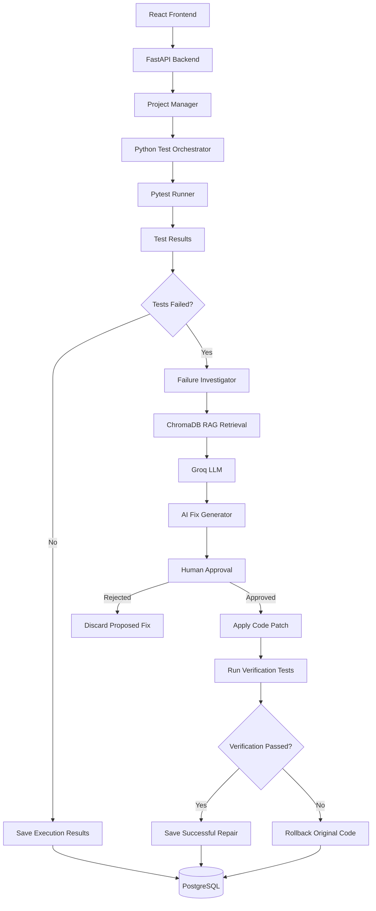

# 🚀 TestPilot AI
### Intelligent Test Automation & AI-Powered Code Repair

[](https://frontend-2cik.vercel.app/)
[](https://testpilot-ai-60j9.onrender.com/)


**TestPilot AI** is an intelligent test automation and repair platform that combines automated test execution, AI-powered failure investigation, Retrieval-Augmented Generation (RAG), and human-approved code repair into a unified workflow.

Instead of simply reporting failed tests, TestPilot AI investigates failures, retrieves relevant historical failure information, generates potential code fixes, and verifies proposed repairs through test execution.

## 🌐 Live Demo

| Component | Link |
|---|---|
| Frontend Dashboard | https://frontend-2cik.vercel.app/ |
| Backend API | https://testpilot-ai-60j9.onrender.com/ |
| API Documentation | https://testpilot-ai-60j9.onrender.com/docs |

## ✨ Key Features

- **Automated Test Execution:** Execute Python test suites using the integrated Pytest runner.
- **AI-Powered Failure Investigation:** Analyze failed test cases and identify potential root causes.
- **RAG-Based Context Retrieval:** Retrieve similar historical failure information using ChromaDB.
- **AI Code Repair:** Generate suggested code modifications based on failure analysis and source code context.
- **Human-in-the-Loop Approval:** Review and approve or reject AI-generated fixes before application.
- **Automated Verification:** Execute tests again after applying an approved fix.
- **Rollback Mechanism:** Restore the original source code if the proposed repair fails verification.
- **Execution History:** Store project execution information and test results in PostgreSQL.
- **Interactive Dashboard:** Manage projects, initiate test executions, and review AI repair proposals.

## 🧠 System Architecture



## 🛠️ Technology Stack

### Frontend
- React.js
- Vite
- JavaScript
- Axios
- Lucide React
- Framer Motion
- CSS

### Backend
- Python
- FastAPI
- Uvicorn
- SQLAlchemy
- Pydantic

### AI & Machine Learning
- LangGraph – Workflow orchestration
- LangChain – LLM integration
- Groq API – Language model inference
- ChromaDB – Vector database for RAG
- Retrieval-Augmented Generation (RAG)

### Testing & Automation
- Pytest
- Python subprocess
- Automated test result parsing
- Source-code extraction and patch application

### Database & Deployment
- PostgreSQL
- Supabase – Hosted PostgreSQL
- Render – Backend deployment
- Vercel – Frontend deployment
- Git and GitHub

## 🔄 How It Works

1. **Project Registration:** Register a project through the dashboard.
2. **Test Execution:** The Python orchestrator invokes the Pytest runner.
3. **Failure Detection:** Failed test cases and their error information are collected.
4. **Failure Investigation:** The AI investigation workflow analyzes the failure and retrieves relevant historical context from ChromaDB.
5. **Fix Generation:** The LLM generates a proposed code modification.
6. **Human Approval:** The developer reviews the suggested fix and approves or rejects it.
7. **Patch Application:** An approved modification is applied to the target source file.
8. **Verification:** The test suite executes again to validate the modification.
9. **Rollback:** If verification fails, the original source code is restored.
10. **Result Storage:** Execution information and test results are persisted in PostgreSQL.

## 📁 Project Structure

```text
TestPilot-AI/
│
├── app/
│   ├── agents/
│   ├── api/
│   │   ├── main.py
│   │   └── routes/
│   ├── graph/
│   ├── rag/
│   ├── runners/
│   ├── schemas/
│   ├── orchestrator.py
│   ├── database.py
│   ├── models.py
│   ├── project_service.py
│   ├── run_service.py
│   └── history_service.py
│
├── frontend/
│   ├── src/
│   │   ├── App.jsx
│   │   ├── App.css
│   │   ├── index.css
│   │   └── api.js
│   ├── package.json
│   └── vite.config.js
│
├── sample_programs/
│   ├── python_programs/
│   └── graph_algorithms/
│
├── demo_project/
├── reports/
├── requirements.txt
├── .gitignore
└── README.md
```

## ⚙️ Local Installation & Setup

### Prerequisites

- Python 3.12+
- Node.js and npm
- PostgreSQL or a Supabase PostgreSQL database
- Groq API key
- Git

### 1. Clone the Repository

```bash
git clone https://github.com/Kashvi039/TestPilot-AI.git
cd TestPilot-AI
```

### 2. Backend Setup

Create and activate a virtual environment:

```bash
python -m venv .venv
```

For Ubuntu/Linux:

```bash
source .venv/bin/activate
```

For Windows PowerShell:

```powershell
.venv\Scripts\Activate.ps1
```

Install dependencies:

```bash
pip install -r requirements.txt
```

### 3. Environment Configuration

Create a `.env` file in the project root:

```env
DB_HOST=your_database_host
DB_PORT=5432
DB_NAME=your_database_name
DB_USER=your_database_user
DB_PASSWORD=your_database_password

GROQ_API_KEY=your_groq_api_key
```

Never commit your `.env` file or expose API keys and database credentials.

### 4. Initialize the Database

```bash
python -m app.create_tables
```

This initializes the required PostgreSQL tables:

- `projects`
- `test_runs`
- `test_results`

### 5. Start the Backend

```bash
uvicorn app.api.main:app --reload
```

Backend runs at:

```text
http://localhost:8000
```

API documentation:

```text
http://localhost:8000/docs
```

### 6. Frontend Setup

Open another terminal:

```bash
cd frontend
npm install
```

Create a frontend `.env` file:

```env
VITE_API_URL=http://localhost:8000
```

Start the development server:

```bash
npm run dev
```

Frontend runs at:

```text
http://localhost:5173
```

## 🗄️ Database Schema

TestPilot AI uses PostgreSQL for persistent execution and project information.

| Table | Purpose |
|---|---|
| `projects` | Stores registered project details |
| `test_runs` | Stores test execution summaries |
| `test_results` | Stores individual test outcomes and failure information |

ChromaDB is used separately for storing and retrieving historical failure context.

## ☁️ Deployment

TestPilot AI uses the following deployment architecture:

| Service | Platform |
|---|---|
| React Frontend | Vercel |
| FastAPI Backend | Render |
| PostgreSQL Database | Supabase |
| Vector Database | ChromaDB |

Frontend environment variable:

```env
VITE_API_URL=https://testpilot-ai-60j9.onrender.com
```

The backend is configured with CORS to allow requests from the deployed frontend.

**Deployment note:** The current project registration and execution workflow expects project source directories to be accessible on the backend server. For projects outside the deployed repository, a project upload or source synchronization mechanism is needed. Render's free filesystem should not be treated as permanent storage.

## 🚧 Current Scope & Future Enhancements

### Currently Implemented
- Python-based test orchestration.
- Pytest test execution.
- AI-powered failure investigation.
- RAG-based failure context retrieval.
- AI-generated code repair proposals.
- Human approval and rejection workflow.
- Verification and rollback workflow.
- PostgreSQL execution history.
- React dashboard and cloud deployment.

### Future Enhancements
- Multi-language test runners for Java, C++, and JavaScript.
- Persistent LangGraph workflow checkpoints.
- Cloud-based project upload and management.
- Advanced execution analytics and reporting.
- User authentication and role-based access.
- CI/CD pipeline integration.
- More advanced AI repair validation.

## 🎯 Project Objective

The goal of TestPilot AI is to move beyond traditional test automation by introducing an intelligent repair workflow that reduces manual debugging effort.

By combining automated testing, historical failure retrieval, LLM-based reasoning, and human oversight, TestPilot AI aims to make software testing more intelligent, efficient, and developer-friendly.

---

## 👩‍💻 Author

**Kashvi Dua**

BE Computer Science Engineering

GitHub: [@Kashvi039](https://github.com/Kashvi039)

**Built with Python, React, AI, and a passion for intelligent automation.**
